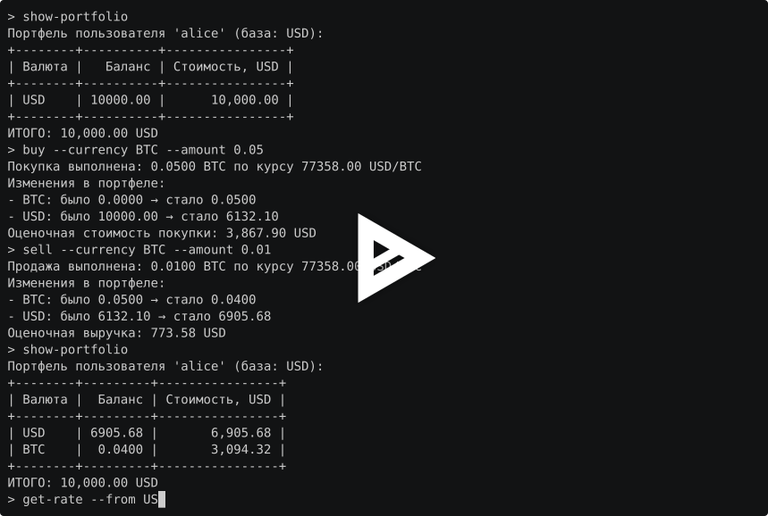

# ValutaTrade Hub

Итоговый проект курса «Программирование на Python» (МИФИ, 1 семестр).

Консольное приложение, имитирующее работу валютного кошелька: позволяет
пользователям регистрироваться, управлять своим виртуальным портфелем
фиатных и криптовалют, совершать сделки по покупке/продаже по актуальным
курсам. Курсы приходят из CoinGecko и ExchangeRate-API, хранятся в локальном
кеше и обновляются по команде или по таймеру.

## Отличия от условий задания

- Полная модель сделок: `buy` списывает USD, `sell` зачисляет USD, иначе
  ИТОГО портфеля после сделок не сходится. Стартовый баланс USD задаётся
  в настройках.
- USD купить и продать нельзя: это расчётная валюта, сделка USD за USD по
  курсу 1 ничего не меняет, а вывод «было 10000.00, стало 10000.00» читался бы
  как ошибка. Пример `sell --currency USD` в условии показывает продажу BTC.
- Шаг учёта `0.00000001` общий для всех валют: цент как шаг хранения заставлял
  бы округлять стоимость каждой сделки с криптовалютой. Два знака у фиатных
  валют и четыре у криптовалют задают точность показа, вывод растёт до восьми
  знаков, когда они есть. Сумма мельче шага усекается, сделка со стоимостью
  меньше шага отклоняется.
- В `rates.json` поле `updated_at` это время получения курса, в
  `exchange_rates.json` поле `timestamp` это время источника. ExchangeRate-API
  обновляет курсы раз в сутки, и со временем источника кеш фиата был бы
  устаревшим при любом TTL короче суток.
- `show-portfolio` показывает кеш без проверки TTL. `get-rate`, `buy` и `sell`
  проверяют TTL и при устаревшем или отсутствующем курсе сами обновляют кеш.
- Суммы в памяти `Decimal`, в JSON числа, как в примерах.
- Пароль хранится как `pbkdf2_hmac` с солью.
- Повторный `login` заменяет сессию, есть команды `logout` и `help`.
- Таблицы `show-portfolio` и `show-rates` выводятся через prettytable.
- Всё время в UTC, в выводе с пометкой `UTC`.
- Папка `data/` создаётся при первом запуске, в git лежит только `.gitkeep`.

## Требования

- Python 3.12+
- uv 0.13+
- Ключ ExchangeRate-API для курсов фиатных валют (бесплатная регистрация).
  Без ключа работают только курсы криптовалют из CoinGecko.

## Установка и запуск

```bash
uv sync
cp .env.example .env    # вписать свой ключ
uv run project
```

Или с make:
```bash
make install
cp .env.example .env    # вписать свой ключ
make run
```

## Демонстрация

Полный цикл: регистрация, вход, портфель, покупка и продажа, курс пары, ошибки,
обновление кеша и просмотр курсов.

[](https://asciinema.org/a/Mf7BSknC81UB3y89)

## Команды

Приглашение `> `, аргументы в форме `--имя значение`. Коды валют можно вводить
в любом регистре. Команды `show-portfolio`, `buy`, `sell` и `logout` требуют
входа.

| Команда | Действие |
|---|---|
| `register --username <str> --password <str>` | зарегистрировать пользователя, завести портфель со стартовым балансом USD |
| `login --username <str> --password <str>` | войти |
| `logout` | выйти из сессии |
| `show-portfolio [--base <str>]` | кошельки и их стоимость в базовой валюте, по умолчанию USD |
| `buy --currency <str> --amount <float>` | купить валюту за USD по свежему курсу |
| `sell --currency <str> --amount <float>` | продать валюту за USD по свежему курсу |
| `get-rate --from <str> --to <str>` | курс пары, время обновления и обратный курс |
| `update-rates [--source <str>]` | обновить кеш курсов из всех источников или из одного: `coingecko`, `exchangerate` |
| `show-rates [--currency <str>] [--top <int>] [--base <str>]` | курсы из кеша с фильтрами |
| `help [команда]` | справка |
| `exit` | выход, `Ctrl-D` завершает так же |

Поддерживаемые валюты: USD, EUR, GBP, RUB и BTC, ETH, SOL.

### Примеры

```
> register --username alice --password 1234
Пользователь 'alice' зарегистрирован (id=1). Войдите: login --username alice --password ****
> login --username alice --password 1234
Вы вошли как 'alice'
> buy --currency BTC --amount 0.05
Покупка выполнена: 0.0500 BTC по курсу 77357.00 USD/BTC
Изменения в портфеле:
- BTC: было 0.0000 → стало 0.0500
- USD: было 10000.00 → стало 6132.15
Оценочная стоимость покупки: 3,867.85 USD
> sell --currency BTC --amount 0.01
Продажа выполнена: 0.0100 BTC по курсу 77357.00 USD/BTC
Изменения в портфеле:
- BTC: было 0.0500 → стало 0.0400
- USD: было 6132.15 → стало 6905.72
Оценочная выручка: 773.57 USD
> show-portfolio
Портфель пользователя 'alice' (база: USD):
+--------+---------+----------------+
| Валюта |  Баланс | Стоимость, USD |
+--------+---------+----------------+
| USD    | 6905.72 |       6,905.72 |
| BTC    |  0.0400 |       3,094.28 |
+--------+---------+----------------+
ИТОГО: 10,000.00 USD
> get-rate --from USD --to BTC
Курс USD→BTC: 0.00001293 (обновлено: 2026-10-31 15:17:29 UTC)
Обратный курс BTC→USD: 77357.00
```

Ошибки печатаются одной строкой и не прерывают сессию:

```
> buy --currency BTC --amount 1
Недостаточно средств: доступно 6905.72 USD, требуется 77357.00 USD
> sell --currency ETH --amount 1
У вас нет кошелька 'ETH'. Добавьте валюту: она создаётся автоматически при первой покупке.
> get-rate --from USD --to ABC
Неизвестная валюта 'ABC'
Поддерживаемые коды: BTC, ETH, EUR, GBP, RUB, SOL, USD
> buy --currency BTC --amount -1
'amount' должен быть положительным числом
> show-portfolio
Сначала выполните login
```

## Курсы и кеш

Курсы хранятся в `data/rates.json`: по одной записи на пару к USD, время
получения и источник, плюс `last_refresh`:

```json
{
  "pairs": {
    "BTC_USD": {"rate": 59337.21, "updated_at": "2025-10-10T12:00:00Z", "source": "CoinGecko"},
    "EUR_USD": {"rate": 1.0786, "updated_at": "2025-10-10T12:00:00Z", "source": "ExchangeRate-API"}
  },
  "last_refresh": "2025-10-10T12:00:01Z"
}
```

Обратные и кросс-курсы считаются из пар к USD: курс USD к BTC это
`1 / BTC_USD`, курс BTC к EUR это `BTC_USD / EUR_USD`.

TTL кеша задаёт настройка `rates_ttl_seconds`, по умолчанию 300 секунд.
Команды `get-rate`, `buy` и `sell` при курсе старше TTL или без курса
в кеше запускают обновление и перечитывают кеш. Если обновление не удалось,
печатается причина и подсказка:

```
> get-rate --from USD --to BTC
Курс USD→BTC недоступен. Повторите попытку позже.
Ошибка при обращении к внешнему API: ни один источник не ответил (CoinGecko: Network error (ConnectionError))
Проверьте сеть и ключ API. Подробности в logs/parser.log
```

История замеров копится в `data/exchange_rates.json`. Идентификатор записи
собирается из пары и времени источника, поэтому один и тот же замер не
записывается дважды:

```json
{
  "id": "BTC_USD_2025-10-10T12:00:00Z",
  "from_currency": "BTC",
  "to_currency": "USD",
  "rate": 59337.21,
  "timestamp": "2025-10-10T12:00:00Z",
  "source": "CoinGecko",
  "meta": {"raw_id": "bitcoin", "request_ms": 124, "status_code": 200, "etag": "W/\"abc123\""}
}
```

Оба файла пишутся атомарно: сначала во временный файл, затем переименование.

## Сервис парсинга

Пакет `valutatrade_hub/parser_service` собирает курсы из двух источников:

- CoinGecko даёт криптовалюты, ключ не нужен, идентификаторы монет берутся
  из `CRYPTO_ID_MAP` в `config.py`.
- ExchangeRate-API даёт фиатные валюты по ключу. Источник отдаёт курсы
  USD к каждой валюте, в кеш пишется обратное значение, курс валюты к USD.

Ключ читается из переменной окружения `EXCHANGERATE_API_KEY` или из файла
`.env` в папке запуска, образец в `.env.example`. Файл `.env` в `.gitignore`,
в журнал адрес запроса пишется с `<key>` вместо ключа.

```
> update-rates
INFO: Starting rates update...
INFO: Fetching from CoinGecko... OK (3 rates)
INFO: Fetching from ExchangeRate-API... OK (3 rates)
INFO: Writing 6 rates to data/rates.json...
Update successful. Total rates updated: 6. Last refresh: 2026-10-31 15:17:29 UTC
> show-rates --top 2
Rates from cache (updated at 2026-10-31 15:17:29 UTC):
+---------+----------+-------------------------+-----------+
| Пара    |     Курс |        Обновлено        | Источник  |
+---------+----------+-------------------------+-----------+
| BTC_USD | 77357.00 | 2026-10-31 15:17:29 UTC | CoinGecko |
| ETH_USD |  2246.21 | 2026-10-31 15:17:29 UTC | CoinGecko |
+---------+----------+-------------------------+-----------+
> show-rates --currency RUB --base EUR
Rates from cache (updated at 2026-10-31 15:17:29 UTC):
+---------+------------+-------------------------+------------------+
| Пара    |       Курс |        Обновлено        | Источник         |
+---------+------------+-------------------------+------------------+
| RUB_EUR | 0.01113807 | 2026-10-31 15:17:29 UTC | ExchangeRate-API |
+---------+------------+-------------------------+------------------+
```

Сбой одного источника не останавливает обновление: его пары остаются в кеше
со старым временем, остальные обновляются, команда заканчивается строкой
`Update completed with errors. Check logs/parser.log for details.`. Если не
ответил ни один источник, кеш не меняется.

`--top N` показывает N самых дорогих криптовалют по курсу к USD, фиатные
валюты в выборку не входят. `--base` пересчитывает все пары к указанной
валюте через кросс-курс.

### Обновление по таймеру

Планировщик запускается отдельным процессом и обновляет курсы с интервалом
`scheduler_interval_seconds` из настроек, остановка по `Ctrl-C`:

```bash
uv run python -m valutatrade_hub.parser_service.scheduler
uv run python -m valutatrade_hub.parser_service.scheduler --interval 60 --runs 3
```

## Конфигурация

Настройки лежат в секции `[tool.valutatrade]` файла `pyproject.toml` в папке
запуска, отсутствующие берутся по умолчанию:

| Ключ | По умолчанию | Назначение |
|---|---|---|
| `data_dir` | `data` | папка с `users.json`, `portfolios.json`, `rates.json`, `exchange_rates.json` |
| `log_dir` | `logs` | папка журналов |
| `log_level` | `INFO` | уровень журнала действий |
| `log_max_bytes`, `log_backup_count` | `1000000`, `3` | ротация файлов журналов |
| `rates_ttl_seconds` | `300` | срок годности курса в кеше |
| `default_base_currency` | `USD` | базовая валюта |
| `start_balance_usd` | `10000` | стартовый баланс нового пользователя |
| `scheduler_interval_seconds` | `300` | интервал планировщика |

## Структура

```
finalproject_medvedev_m26-555/
├── data/                       # users.json, portfolios.json, rates.json, exchange_rates.json
├── logs/                       # actions.log, parser.log
├── valutatrade_hub/
│   ├── logging_config.py       # журналы: формат, ротация, консоль на время update-rates
│   ├── decorators.py           # @log_action
│   ├── core/
│   │   ├── currencies.py       # Currency, FiatCurrency, CryptoCurrency, реестр
│   │   ├── exceptions.py       # доменные исключения
│   │   ├── models.py           # User, Wallet, Portfolio, Rate, RatesSnapshot
│   │   ├── usecases.py         # register, login, buy, sell, get_rate, show_portfolio, update_rates, show_rates
│   │   └── utils.py            # время, пароли, Decimal, форматирование
│   ├── infra/
│   │   ├── settings.py         # SettingsLoader
│   │   └── database.py         # DatabaseManager
│   ├── parser_service/
│   │   ├── config.py           # ParserConfig
│   │   ├── api_clients.py      # BaseApiClient, CoinGeckoClient, ExchangeRateApiClient
│   │   ├── updater.py          # RatesUpdater, UpdateResult
│   │   ├── storage.py          # RatesStorage: rates.json и exchange_rates.json
│   │   └── scheduler.py        # RatesScheduler
│   └── cli/
│       └── interface.py        # цикл команд, таблица COMMANDS, вывод
├── tests/
├── main.py
├── pyproject.toml
├── docs/                       # превью записи демо
├── .env.example
└── README.md
```

## Журналы

`logs/actions.log` пишет декоратор `@log_action` на `buy` и `sell`: одна
строка на сделку, при ошибке тип и текст ошибки.

```
INFO 2026-10-31T15:17:29 BUY user='alice' currency='BTC' amount=0.0500 rate=77357.00 base='USD' result=OK
ERROR 2026-10-31T15:17:29 SELL user=1 currency='ETH' amount=1 result=ERROR error_type=WalletNotFoundError error_message='У вас нет кошелька 'ETH'. Добавьте валюту: она создаётся автоматически при первой покупке.'
```

`logs/parser.log` пишет парсер на уровне DEBUG: шаги обновления, адреса
запросов без ключа, время ответа, трассировки ошибок. Оба файла с ротацией
по размеру.

## Архитектурные решения

- `usecases` зовут `DatabaseManager` и `SettingsLoader` напрямую, как задано
  в разделе про бизнес-логику.
- Синглтоны через `__new__`.
- `Rate` как объект-значение: обратный и кросс-курс считаются от
  неокруглённого значения, округление только при выводе.
- `RatesSnapshot` одна модель для чтения кеша в ядре и для записи в парсере.
- Ядро вызывает парсер через одну функцию `refresh_rates`, в тестах она
  подменяется, и тесты не ходят в сеть.
- Сессия живёт в CLI, ядро без состояния. CLI разбирает команды, зовёт
  usecases и печатает результат, ошибки перехватываются в одном месте.
- Кеш прочитанных файлов в `DatabaseManager` на замыкании, сбрасывается
  любой записью.

## Разработка

```bash
make check   # ruff check + ruff format --check
make fix     # автоисправления ruff и форматирование
make test    # pytest
```
